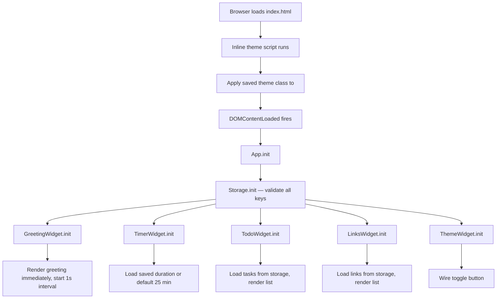
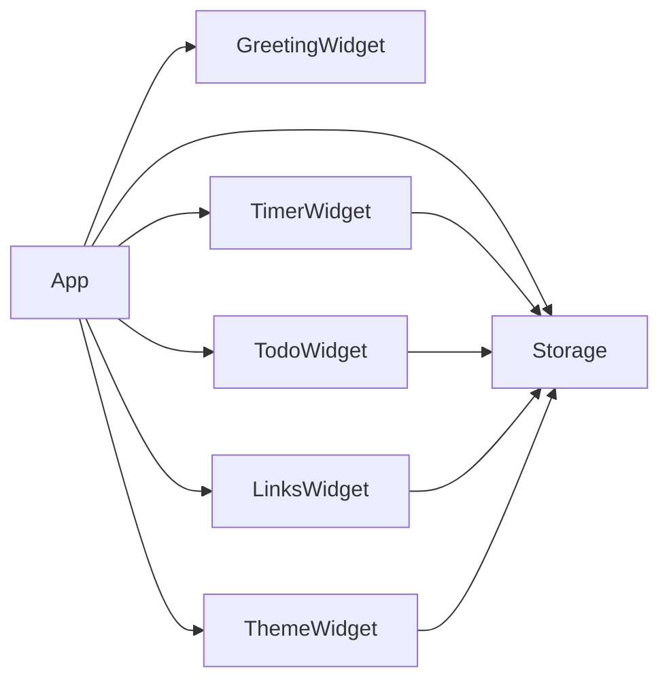
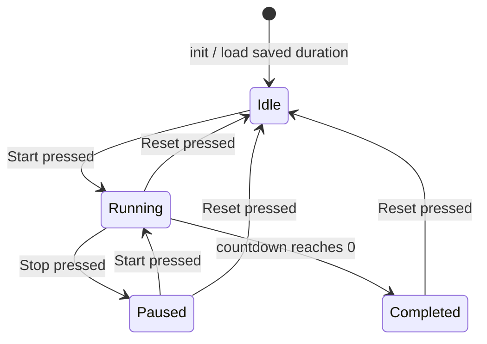

# Design Document

## Overview

The To-Do List Life Dashboard is a fully client-side, single-page web application built with plain HTML, CSS, and Vanilla JavaScript — no frameworks, no build tools, no server. It delivers four interactive widgets (Greeting, Focus Timer, To-Do List, Quick Links) plus a Light/Dark Mode toggle, all wired together through a lightweight module pattern in a single `js/app.js` file. All state is persisted in the browser's `localStorage` API using distinct, namespaced keys.

The design philosophy is intentional simplicity: one HTML file, one CSS file, one JS file, zero external dependencies. Every architectural decision — from the module pattern to the CSS custom-property theme system — is chosen to keep the codebase readable and maintainable without a build step.

---

## Architecture

The application follows a **widget-module pattern**: each widget is a self-contained JavaScript object with `init`, `render`, and event-handler methods. A top-level `App` controller coordinates initialization order and shared concerns (theme loading, storage utilities).

### High-Level Flow



### Module Dependency Map



### File Structure

```
index.html          ← single HTML shell; contains inline theme-init script
css/
  style.css         ← all styles; uses CSS custom properties for theming
js/
  app.js            ← all JavaScript; IIFE modules, no imports/exports
```

---

## Components and Interfaces

### Storage Module

Responsible for all `localStorage` interactions. Provides a uniform read/write/delete API with JSON serialization, graceful corrupt-data handling, and the canonical key constants.

```javascript
const Storage = (() => {
  const KEYS = {
    TASKS:          'tld_tasks',
    LINKS:          'tld_links',
    TIMER_DURATION: 'tld_timer_duration',
    THEME:          'tld_theme',
  };

  /** @returns {*} parsed value, or `defaultValue` on missing/corrupt data */
  function get(key, defaultValue) { ... }

  /** Serialises value as JSON and writes to localStorage */
  function set(key, value) { ... }

  /** Removes a key */
  function remove(key) { ... }

  return { KEYS, get, set, remove };
})();
```

### Greeting Widget

Renders the date, time, and contextual greeting. Drives its own `setInterval` tick.

```javascript
const GreetingWidget = (() => {
  /** Returns greeting string for a given 0–23 hour */
  function getGreeting(hour) { ... }

  /** Formats a Date to "Weekday, Month D, YYYY" */
  function formatDate(date) { ... }

  /** Formats a Date to "HH:MM:SS" */
  function formatTime(date) { ... }

  /** Renders current date/time/greeting; called on init and every second */
  function render() { ... }

  function init() {
    render();                          // immediate render — no blank period
    setInterval(render, 1000);
  }

  return { init };
})();
```

### Timer Widget

Manages countdown state machine, custom-duration persistence, and completion alerts.

```javascript
const TimerWidget = (() => {
  // State
  let totalSeconds;   // configured session length in seconds
  let remaining;      // current countdown value in seconds
  let intervalId;     // setInterval handle, or null when idle
  let running;        // boolean

  const DEFAULT_MINUTES = 25;
  const MIN_MINUTES = 1;
  const MAX_MINUTES = 60;

  /** Formats integer seconds to "MM:SS" string */
  function formatTime(seconds) { ... }

  /** Returns null if valid, or an error string if invalid */
  function validateDuration(minutes) { ... }

  /** Plays completion audio via Web Audio API (no external files needed) */
  function playAlert() { ... }

  function start() { ... }
  function stop()  { ... }
  function reset() { ... }
  function tick()  { ... }  // called by interval; fires completion at 0

  function init() { ... }

  return { init };
})();
```

Timer state machine:



### Todo Widget

Manages the task array (add, edit, delete, toggle), sort order, and rendering.

```javascript
const TodoWidget = (() => {
  const MAX_TITLE_LENGTH = 100;

  /** Returns null if valid, or an error string */
  function validateTitle(title) { ... }   // trims, checks length 1–100

  /** Returns a new sorted copy of tasks without mutating the original array */
  function sortTasks(tasks, criterion) { ... }  // 'default' | 'alpha' | 'completed-last'

  /** Renders the current task list to the DOM */
  function renderList() { ... }

  function addTask(title)           { ... }
  function toggleTask(id)           { ... }
  function editTask(id, newTitle)   { ... }
  function deleteTask(id)           { ... }

  function init() { ... }

  return { init };
})();
```

Task data shape:

```javascript
// Stored as a JSON array under KEYS.TASKS
{
  id:        string,   // crypto.randomUUID() or Date.now().toString()
  title:     string,   // 1–100 characters
  completed: boolean,
  createdAt: number,   // Unix timestamp for default sort
}
```

### Links Widget

Manages the quick-link array (add, delete) and rendering.

```javascript
const LinksWidget = (() => {
  /** Returns null if valid label, or error string */
  function validateLabel(label) { ... }

  /** Returns null if valid URL (starts with http:// or https://), or error string */
  function validateUrl(url) { ... }

  function renderList() { ... }
  function addLink(label, url)  { ... }
  function deleteLink(id)       { ... }

  function init() { ... }

  return { init };
})();
```

Link data shape:

```javascript
// Stored as a JSON array under KEYS.LINKS
{
  id:    string,
  label: string,
  url:   string,   // must start with http:// or https://
}
```

### Theme Widget

Manages theme toggling and the inline theme-init script that prevents flash.

```javascript
const ThemeWidget = (() => {
  const DARK_CLASS  = 'theme-dark';
  const LIGHT_VALUE = 'light';
  const DARK_VALUE  = 'dark';

  function applyTheme(value) { ... }  // adds/removes DARK_CLASS on <body>
  function toggle()          { ... }  // flips stored theme and re-applies

  function init() { ... }  // wires toggle button

  return { init };
})();
```

Inline theme-init script (placed in `<head>` of `index.html`, before any CSS):

```html
<script>
  (function() {
    var t = localStorage.getItem('tld_theme');
    if (t === 'dark') document.documentElement.classList.add('theme-dark');
  })();
</script>
```

This runs synchronously before the first paint, eliminating any flash of wrong theme.

---

## Data Models

### Task

| Field       | Type    | Constraints                     | Storage |
|-------------|---------|----------------------------------|---------|
| `id`        | string  | unique, non-empty               | persisted |
| `title`     | string  | 1–100 characters, trimmed       | persisted |
| `completed` | boolean | default `false`                 | persisted |
| `createdAt` | number  | Unix ms timestamp               | persisted |

### Quick Link

| Field   | Type   | Constraints                                      | Storage |
|---------|--------|--------------------------------------------------|---------|
| `id`    | string | unique, non-empty                               | persisted |
| `label` | string | non-empty after trim                            | persisted |
| `url`   | string | starts with `http://` or `https://`             | persisted |

### Timer Configuration

| Field      | Type   | Constraints         | Storage key         |
|------------|--------|---------------------|---------------------|
| `duration` | number | integer, 1–60 (min) | `tld_timer_duration` |

### Theme Preference

| Field   | Type   | Constraints              | Storage key  |
|---------|--------|--------------------------|--------------|
| `theme` | string | `'light'` \| `'dark'`   | `tld_theme`  |

### localStorage Key Registry

| Key                  | Widget        | Value shape           |
|----------------------|---------------|-----------------------|
| `tld_tasks`          | Todo          | `Task[]` (JSON array) |
| `tld_links`          | Links         | `Link[]` (JSON array) |
| `tld_timer_duration` | Timer         | number (minutes)      |
| `tld_theme`          | Theme         | `'light'` \| `'dark'`|

All keys use the `tld_` prefix to avoid collisions with other applications sharing the same origin.

---

## Correctness Properties

*A property is a characteristic or behavior that should hold true across all valid executions of a system — essentially, a formal statement about what the system should do. Properties serve as the bridge between human-readable specifications and machine-verifiable correctness guarantees.*

### Property 1: Greeting hour mapping is exhaustive and correct

*For any* integer hour in [0, 23], `getGreeting(hour)` SHALL return exactly one of the four greeting strings, and the returned string SHALL match the range specification: "Good Morning" for [5, 11], "Good Afternoon" for [12, 17], "Good Evening" for [18, 21], "Good Night" for [22, 23] ∪ [0, 4].

**Validates: Requirements 1.3, 1.4, 1.5, 1.6**

---

### Property 2: Time formatter produces valid MM:SS for all representable seconds

*For any* integer `s` in [0, 3599], `TimerWidget.formatTime(s)` SHALL return a string that matches the pattern `^[0-5]\d:[0-5]\d$`, and the numeric values of the MM and SS parts SHALL satisfy `MM * 60 + SS === s`.

**Validates: Requirements 2.1**

---

### Property 3: Timer duration validation partitions the domain correctly

*For any* integer `m`, `validateDuration(m)` SHALL return `null` (valid) if and only if `1 ≤ m ≤ 60`; it SHALL return a non-empty error string for all other integers.

**Validates: Requirements 2.7, 2.8**

---

### Property 4: Timer duration round-trip through localStorage

*For any* integer `m` in [1, 60], saving `m` as the timer duration and then reading it back from `localStorage` SHALL recover the same integer `m`.

**Validates: Requirements 2.7, 7.2**

---

### Property 5: Task title validation partitions the domain correctly

*For any* string `s`, `validateTitle(s)` SHALL return `null` (valid) if and only if `s.trim()` has length in [1, 100]; it SHALL return a non-empty error string for empty strings, all-whitespace strings, and strings whose trimmed form exceeds 100 characters.

**Validates: Requirements 3.1, 3.2, 3.6**

---

### Property 6: Adding a valid task increases the stored list length by exactly one

*For any* task list of length `n` and any valid title `t` (1–100 non-whitespace characters), calling `addTask(t)` SHALL result in a stored task array of length `n + 1` whose last-added entry has `title === t.trim()` and `completed === false`.

**Validates: Requirements 3.1, 7.2**

---

### Property 7: Task completion toggle is an involution

*For any* task, calling `toggleTask` twice SHALL return the task to its original `completed` state — i.e., `toggle(toggle(task)).completed === task.completed`.

**Validates: Requirements 3.3, 3.4**

---

### Property 8: Deleting a task removes it from persistent storage

*For any* task list and any task `t` in that list, calling `deleteTask(t.id)` SHALL result in a stored task array that contains no element with `id === t.id`.

**Validates: Requirements 3.7, 7.2**

---

### Property 9: Task list round-trip through localStorage

*For any* array of valid task objects written to `localStorage` under `tld_tasks`, initialising `TodoWidget` SHALL restore a list whose length and per-item `{ id, title, completed }` values match the persisted array exactly.

**Validates: Requirements 3.8, 7.3**

---

### Property 10: Sort does not mutate localStorage

*For any* task list and any sort criterion, applying `sortTasks` SHALL produce a correctly ordered result array AND the value stored under `tld_tasks` SHALL remain byte-for-byte identical to its value before the sort call.

**Validates: Requirements 3.9, 3.10**

---

### Property 11: URL validation rejects all non-http(s) prefixes

*For any* string `u`, `validateUrl(u)` SHALL return `null` (valid) if and only if `u` starts with `http://` or `https://`; it SHALL return a non-empty error string for all other strings (including empty, `ftp://`, `//`, relative paths, etc.).

**Validates: Requirements 4.1, 4.3**

---

### Property 12: Quick Link round-trip through localStorage

*For any* array of valid link objects written to `localStorage` under `tld_links`, initialising `LinksWidget` SHALL restore a list whose length and per-item `{ id, label, url }` values match the persisted array exactly.

**Validates: Requirements 4.6, 7.3**

---

### Property 13: Theme preference round-trip through localStorage

*For any* theme value in `{'light', 'dark'}`, saving it and then re-initialising the dashboard SHALL apply the correct CSS class state to `<body>` — `theme-dark` class present for `'dark'`, absent for `'light'`.

**Validates: Requirements 5.3, 5.4**

---

### Property 14: Corrupt localStorage data never throws an uncaught error

*For any* string written to any `tld_*` key that is not valid JSON, or that is valid JSON but does not match the expected data shape, calling `Storage.get(key, defaultValue)` SHALL return `defaultValue` without throwing any exception.

**Validates: Requirements 7.4**

---

## Error Handling

### Validation Errors (User Input)

All validation is performed before any state mutation. Errors are displayed **inline**, adjacent to the offending input, as a `<span>` with a dedicated error class. They are cleared on the next valid submission or when the user begins typing.

| Scenario | Widget | Message |
|----------|--------|---------|
| Empty task title | Todo | "Task title is required." |
| Task title > 100 chars | Todo | "Title must be 100 characters or fewer." |
| Empty link label | Links | "Label is required." |
| Invalid link URL | Links | "URL must start with http:// or https://." |
| Timer duration out of range | Timer | "Duration must be between 1 and 60 minutes." |

### localStorage Failures

`Storage.get` wraps `JSON.parse` in a `try/catch`. On any exception (corrupt JSON, `SecurityError`, quota) it logs a `console.warn` and returns the provided `defaultValue`. Writes wrap `localStorage.setItem` similarly — on failure the UI continues to function, but the user is not shown a persistent error (data loss is a browser-level constraint they cannot resolve from the app).

### Timer Completion

When `remaining` reaches 0:
1. `clearInterval(intervalId)` — stops the tick.
2. The display locks at `00:00`.
3. A `<div class="alert-banner">` is injected into the Timer widget DOM.
4. An audible beep is generated via the **Web Audio API** (no external audio files needed): a short 440 Hz sine wave lasting 0.5 s.
5. The Start button is disabled until Reset is pressed.

### Audio API Fallback

If `window.AudioContext` (or `window.webkitAudioContext`) is not available, the audio step is silently skipped. The visual alert still fires.

---

## Testing Strategy

### Dual Approach

All testable logic lives in **pure functions** extracted from widget modules. Tests import (or inline-load) `app.js` and exercise these functions directly — no DOM automation framework required for unit/property tests. Integration-level tests (responsive layout, cross-browser, accessibility) are handled separately.

### Unit Tests

Focus on specific examples, boundary values, and error paths:

- `getGreeting` — each boundary hour (4, 5, 11, 12, 17, 18, 21, 22, 0)
- `formatDate` — known dates matching expected string format
- `formatTime` — 0 → "00:00", 59 → "00:59", 3599 → "59:59"
- Timer start/stop/reset sequences using fake timers (`jest.useFakeTimers` or equivalent)
- `toggleTask` on a completed and an incomplete task
- `sortTasks` with all three criteria on a mixed list
- `addTask` / `deleteTask` / `editTask` — happy paths and validation failures
- `addLink` / `deleteLink` — happy paths and validation failures
- Theme toggle — light→dark→light round-trip
- `Storage.get` with corrupt JSON string — verify default returned, no throw

### Property-Based Tests

Library: **[fast-check](https://github.com/dubzzz/fast-check)** (CDN-loadable, no build step needed for testing; or run via Node with `npx`).

Each property test runs a **minimum of 100 iterations**. Each test is tagged with a comment referencing the design property it validates.

| Property | Test Description | Generator |
|---|---|---|
| P1 | Greeting mapping is exhaustive | `fc.integer({ min: 0, max: 23 })` |
| P2 | formatTime MM:SS invariant | `fc.integer({ min: 0, max: 3599 })` |
| P3 | Duration validation partition | `fc.integer({ min: -1000, max: 1000 })` |
| P4 | Duration localStorage round-trip | `fc.integer({ min: 1, max: 60 })` |
| P5 | Title validation partition | `fc.string()` + `fc.string({ minLength: 101 })` |
| P6 | addTask grows list by 1 | `fc.string({ minLength: 1, maxLength: 100 })` filtered to non-whitespace |
| P7 | toggleTask is an involution | `fc.boolean()` (initial completed state) |
| P8 | deleteTask removes from storage | arbitrary task array + index |
| P9 | Task list localStorage round-trip | `fc.array(arbitraryTask)` |
| P10 | Sort does not mutate localStorage | `fc.array(arbitraryTask)` × `fc.constantFrom('default','alpha','completed-last')` |
| P11 | URL validation partition | `fc.string()` with `fc.webUrl()` for valid branch |
| P12 | Link list localStorage round-trip | `fc.array(arbitraryLink)` |
| P13 | Theme round-trip | `fc.constantFrom('light','dark')` |
| P14 | Corrupt storage never throws | `fc.string()` (arbitrary corrupt JSON) |

Tag format in test source:
```javascript
// Feature: todo-life-dashboard, Property 1: Greeting hour mapping is exhaustive and correct
```

### Integration / Smoke Tests

- **Responsive layout**: manual verification at 320 px, 768 px, 1440 px, 2560 px viewports.
- **Cross-browser**: manual smoke tests in Chrome, Firefox, Edge, Safari.
- **WCAG contrast**: automated scan using [axe-core](https://github.com/dequelabs/axe-core) bookmarklet on both themes.
- **No-flash theme**: verify in DevTools Network throttling (Slow 3G) that body class is present before first paint.
- **localStorage isolation**: verify that all reads/writes use the `tld_*` key namespace (grep over `app.js`).
